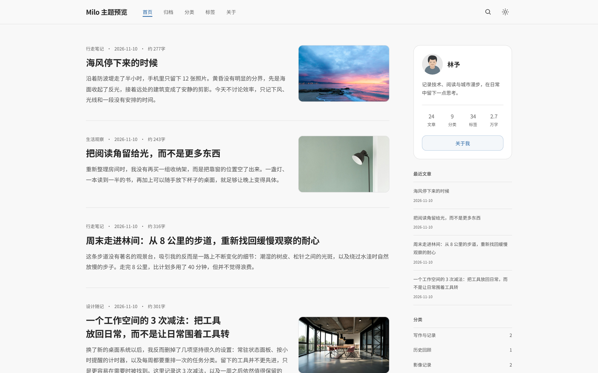

# Milo

Milo 是一款轻量的 Hexo 博客主题，适合以文章阅读为主的个人博客。它会随屏幕宽度调整布局，提供浅色与深色外观、站内搜索、文章目录和阅读进度，也可按需开启评论、订阅和图片灯箱。

[在线演示](https://demo.tanwenhao.com) · [版本下载](https://github.com/twhao/hexo-theme-milo/releases) · [安装与启用](#安装与启用) · [更新记录](CHANGELOG.md)



> 截图使用示例内容，实际界面以你安装的版本为准。

开始前，请准备一个可以正常生成页面的 Hexo 博客。首次搭建博客可参考 [Hexo 官方文档](https://hexo.io/zh-cn/docs/)。

**兼容性**　已在 Node.js 26.13.0 和 Hexo 8.1.2 下验证。Milo 要求 Node.js 18 或更高版本，Hexo 8.1.2 要求 Node.js 20.19 或更高版本。请同时满足所用 Hexo 和插件的要求。其他版本尚未完整验证。

## 目录

- [安装与启用](#安装与启用)
- [配置文件放在哪里](#配置文件放在哪里)
- [功能开关速查](#功能开关速查)
- [设置头像、简介与网站图标](#设置头像简介与网站图标)
- [启用搜索、归档、分类、标签和关于页](#启用搜索归档分类标签和关于页)
- [文章封面与专属参数](#文章封面与专属参数)
- [阅读、评论、订阅与 SEO](#阅读评论订阅与-seo)
- [常用命令](#常用命令)
- [更新与卸载](#更新与卸载)
- [常见问题](#常见问题)
- [项目与许可证](#项目与许可证)

## 安装与启用

### 1. 把 Milo 安装到已有博客

打开终端，先进入 **Hexo 博客根目录**（即包含站点 `_config.yml`、`source/`、`themes/` 的文件夹），然后执行：

```bash
git clone https://github.com/twhao/hexo-theme-milo.git themes/milo
npm install --prefix themes/milo --omit=dev
npm install hexo-renderer-ejs hexo-renderer-marked hexo-generator-index hexo-generator-archive hexo-generator-category hexo-generator-tag
```

第一行下载主题，第二行安装主题依赖，第三行安装站点需要的渲染器和页面生成器。这三条命令都在博客根目录执行。

也可以下载指定版本的源代码压缩包。解压后，将包含 `_config.yml`、`layout/` 和 `scripts/` 的主题文件直接放入 `themes/milo/`，然后在博客根目录执行上面两条 `npm install` 命令。请从 [版本发布页](https://github.com/twhao/hexo-theme-milo/releases) 选择版本。

> **如何选版本**　上述 Git 命令下载默认分支，其中可能包含开发中的改动。需要固定版本时，请下载对应的压缩包，并在版本发布页确认它是预发布还是正式版。

### 2. 在 Hexo 中选择 Milo

打开 **博客根目录**的 `_config.yml`（不是 `themes/milo/_config.yml`），将 `theme` 设置为：

```yaml
theme: milo
```

博客名称和作者信息仍属于 Hexo 站点配置，例如：

```yaml
title: 我的博客
author: 博客作者
language: zh-CN
```

已有的 `url`、`root` 应与你真实的部署地址一致；使用子目录部署时尤其要检查 `root`。不要为了启用主题而覆盖整份站点配置。

### 3. 添加 Milo 的独立配置文件

将 `themes/milo/_config.yml.example` **复制到博客根目录**，重命名为：

```text
_config.milo.yml
```

这是你日常修改 Milo 的主要地方。**不要将它复制成 `_config.yml`，也不要覆盖博客原有的 `_config.yml`。**

> `themes/milo/_config.yml` 是主题默认值；博客根目录 `_config.milo.yml` 用于覆盖你自己的设置。建议优先修改后者，方便以后更新主题。

### 4. 预览效果

在博客根目录执行：

```bash
npx hexo clean
npx hexo generate
npx hexo server
```

打开终端提示的地址，通常是 **http://localhost:4000/**。如果提示找不到 `hexo server`，可先在博客根目录执行 `npm install hexo-server`。

成功后，首页就会使用 Milo 的布局。文章仍是你原有的 Hexo 文章，不会因为更换主题而被删除。

## 配置文件放在哪里

| 位置 | 作用 | 应该如何修改 |
| --- | --- | --- |
| 博客根目录 `_config.yml` | 网站标题、作者、网址、语言、主题名称、分页 | 修改已有的站点配置 |
| 博客根目录 `_config.milo.yml` | Milo 的外观及功能开关 | **优先修改这里** |
| `themes/milo/_config.yml` | Milo 默认配置 | 通常无需修改 |
| `source/` | 博客文章、页面及个人图片资源 | 放置你自己的内容 |

例如，博客中可能有这样的结构：

```text
我的-Hexo-博客/
├── _config.yml              # Hexo 站点配置；theme: milo
├── _config.milo.yml         # Milo 个人设置
├── source/
│   ├── _posts/
│   ├── images/
│   ├── about/
│   ├── search/
│   ├── tags/
│   └── categories/
└── themes/
    └── milo/
        ├── _config.yml
        ├── _config.yml.example
        ├── layout/
        ├── scripts/
        └── source/
```

## 功能开关速查

以下设置写在**博客根目录的 `_config.milo.yml`**。如果文件里还没有对应字段，可以按 YAML 缩进自行添加。

| 配置项 | 默认值 | 作用 |
| --- | --- | --- |
| `search.enable` | `true` | 开启／关闭站内搜索；关闭时不生成 `search.json` |
| `toc.enable` | `true` | 开启／关闭文章目录 |
| `reading.lightbox` | `false` | 是否开启正文图片灯箱 |
| `sidebar.sticky` | `true` | 桌面端最近文章与分类区域是否吸附 |
| `feed.enable` | `true` | 是否生成内置 Atom 订阅 |
| `feed.limit` | `20` | Atom 中包含的最新文章数量 |
| `comment.disqus.shortname` | 空 | 填写 Disqus shortname 以启用评论；留空关闭 |
| `uiux.slogan` | 空 | 作者卡片与关于页的简介 |
| `img.avatar` | 空 | 作者头像地址 |
| `head.favicon.ico` | 空 | 网站图标地址 |
| `seo.image` | 空 | 社交分享时优先使用的图片 |
| `uiux.primary_color` | 默认主题色 | 主强调色，可填写 CSS 颜色 |
| `uiux.link_color` | 默认主题色 | 链接颜色 |
| `uiux.bg_color` | 默认背景色 | 页面背景颜色 |
| `footer.custom_text` | 空 | 自定义页脚内容；仅填写自己信任的 HTML |
| `footer.copyright_since` | `0` | 版权起始年份；`0` 表示当前年份 |

例如，只想关闭目录和侧栏吸附、启用图片灯箱，可以写：

```yaml
toc:
  enable: false

sidebar:
  sticky: false

reading:
  lightbox: true
```

**注意：** YAML 中缩进使用空格，不要用 Tab。重复定义同一个顶层键（例如写两段 `reading:`）可能覆盖此前的设置，建议合并到同一段。

## 设置头像、简介与网站图标

假设你将两张图片放在博客根目录下：

```text
source/images/avatar.png
source/images/favicon.ico
```

就可以在 `_config.milo.yml` 中写：

```yaml
uiux:
  slogan: 记录生活与思考

img:
  avatar: /images/avatar.png

head:
  favicon:
    ico: /images/favicon.ico
```

昵称默认读取 Hexo 站点 `_config.yml` 中的 `author`，不需要在 Milo 中额外设置。请使用自己的图片，主题不会附带个人头像或文章。

## 启用搜索、归档、分类、标签和关于页

Milo 已提供这些页面的布局；其中**搜索、标签、分类、关于页**建议按下面的文件路径建立页面，以显示对应内容。

下表列出示例文件和复制位置。请从 `themes/milo/examples/pages/` 取用示例，复制到**博客根目录的 `source/`**。

| 复制来源（主题目录内） | 复制目标（博客 `source/` 下） | 页面地址 |
| --- | --- | --- |
| `examples/pages/search.md` | `search/index.md` | `/search/` |
| `examples/pages/tags.md` | `tags/index.md` | `/tags/` |
| `examples/pages/categories.md` | `categories/index.md` | `/categories/` |
| `examples/pages/about.md` | `about/index.md` | `/about/` |

例如，复制搜索示例后的文件内容类似这样：

```yaml
---
title: 搜索
layout: search
comments: false
---
```

**请保留 `layout` 字段**，Hexo 会用它选择对应的页面布局。关于页可在文件的第二个 `---` 下方直接用 Markdown 写个人介绍。归档页由已安装的 Hexo 归档生成器生成，通常不必手动创建。

点击导航栏的搜索图标，输入关键词并按 Enter 即可搜索站内文章。此功能无需第三方搜索服务。关闭 `search.enable` 时，搜索入口和索引会一起关闭。

## 文章封面与专属参数

Milo 读取文章顶部的 **Front Matter**（两个 `---` 之间的 YAML）来控制封面、目录等行为。

### 首页封面

先将图片放到博客的 `source/images/`，例如 `source/images/cover.jpg`，然后在某篇文章中写：

```yaml
---
title: 我的第一篇文章
categories: 随笔
tags:
  - 记录
cover: /images/cover.jpg
cover_fit: cover
---
```

| 参数 | 用法 |
| --- | --- |
| `cover` | 指定首页文章封面，优先级高于 `thumbnail` |
| `thumbnail` | 未指定 `cover` 时使用的备用封面 |
| `cover_fit: cover` | 默认值，填满 16:10 封面区域；照片可能被适度裁切 |
| `cover_fit: contain` | 在 16:10 区域内完整显示图片，适合网页截图，可能留白 |

**正文首图不会自动成为首页封面。** 设置了 `cover` 也不会自动在文章正文插入同一张图片；若正文也需要显示，请在 Markdown 中正常插入。

### 单篇文章的可选设置

```yaml
---
title: 一篇不显示目录的文章
toc: false
comments: false
lightbox: false
---
```

- `toc: false`：只关闭这篇文章的目录；全局开关为 `toc.enable`。
- `comments: false`：只关闭这篇文章的评论。
- `lightbox: false`：只关闭这篇文章的图片灯箱（全局开启灯箱时适用）。

### 正文截图

通常直接使用 Markdown 图片语法即可：

```md

```

如果要让截图完整显示，并帮助浏览器提前预留图片空间，可以填写图片的真实宽高：

```html

```

`width` 与 `height` 应填写原图的真实像素尺寸。远程图片或无法自动识别尺寸的图片尤其建议手动填写，以减少页面加载时的布局跳动。

## 阅读、评论、订阅与 SEO

### 阅读体验

Milo 包含桌面文章目录、手机折叠目录、阅读进度、代码复制和可选灯箱。目录会根据文章中的 Markdown 标题自动生成；无需手动维护目录清单。

深浅色模式可在右上角切换，也支持跟随系统。关闭目录或启用灯箱，只需修改前述配置开关，不需要额外插件。

### Disqus 评论（可选）

在 `_config.milo.yml` 中填写你自己的 Disqus shortname：

```yaml
comment:
  disqus:
    shortname: your-shortname
```

留空即关闭。启用时，访客需要主动点击“加载评论”才会连接 Disqus。这里的 `your-shortname` 只是占位符，请替换成自己的站点标识。

### Atom 订阅

Milo 默认生成 `/atom.xml`，最多包含最近 20 篇文章：

```yaml
feed:
  enable: true
  limit: 20
```

如果你的博客已经安装其他 Feed 生成器，主题会优先保留站点现有方案，避免生成冲突。需要关闭 Milo 内置订阅时，设置 `feed.enable: false`。

### SEO 与分享图片

Milo 会生成常见的页面标题、描述、Canonical、Open Graph 和 Twitter Card 元信息。你可以配置分享图片：

```yaml
seo:
  image: /images/share-cover.jpg
```

分享图建议使用适合社交卡片的横向图片。网站真实域名、子路径及部署配置仍在 Hexo 站点中维护。

## 常用命令

**Milo 本身不是单独运行的程序。** 日常预览、构建和部署依然使用 Hexo 命令；下面列的是使用 Milo 时最常用的操作。

### 博客根目录执行

| 命令 | 用途 |
| --- | --- |
| `npx hexo server` | 本地预览博客 |
| `npx hexo generate` | 生成静态网站文件 |
| `npx hexo clean` | 清理旧生成文件与缓存，排查配置不生效时使用 |
| `npx hexo deploy` | 使用**博客自己已配置**的部署插件发布；Milo 不提供部署工具 |
| `npm install --prefix themes/milo --omit=dev` | 安装或更新主题构建依赖 |

修改 `_config.yml` 或 `_config.milo.yml` 后，一般需要**重启 Hexo Server**。普通文章和样式修改不必每次都执行 `clean`。

### 主题维护者／开发者专用

以下命令在 `themes/milo/` 内执行，普通使用者**不需要运行**：

```bash
npm install          # 安装开发依赖
npm run check        # JavaScript 语法检查
npm test             # 主题自动化测试
npm run test:browser # 主题浏览器测试
```

主题开发者可参阅 [VERIFICATION.md](VERIFICATION.md) 和 [CONTRIBUTING.md](CONTRIBUTING.md)。这些命令是主题开发测试工具，不是 Hexo 站点的发布命令。

## 更新与卸载

**更新前请备份**博客根目录的 `_config.milo.yml`，以及任何直接修改过的主题源文件。

- **Git 安装、跟随默认分支：** 在博客根目录执行 `git -C themes/milo pull --ff-only`，然后执行 `npm install --prefix themes/milo --omit=dev`。如果主题处于标签（detached HEAD）或存在本地修改，请不要直接运行 `pull`。
- **通过压缩包安装：** 到 [版本发布页](https://github.com/twhao/hexo-theme-milo/releases) 获取希望升级到的版本，按版本说明更换主题文件，并重新安装主题依赖。不要将主分支自动更新误认为固定版本升级。
- **卸载：** 先在博客站点 `_config.yml` 中切换到其他已安装主题，再删除 `themes/milo/`。`_config.milo.yml` 可自行保留或移除；博客文章不会因为卸载 Milo 而删除。

## 常见问题

<details>
<summary><strong>切换到 Milo 后没有样式，或者打开页面是 404？</strong></summary>

检查 `theme: milo` 是否写在博客根目录的 `_config.yml`；确认实际目录为 `themes/milo/`；再运行 `npx hexo clean && npx hexo generate`，重启本地服务。部署到子路径时，核对站点的 `url` 和 `root`。
</details>

<details>
<summary><strong>搜索、分类、标签或关于页打不开？</strong></summary>

先检查是否按照[页面创建表](#启用搜索归档分类标签和关于页)复制示例文件，并保留正确的 `layout`。搜索还需 `search.enable: true`，且有可供搜索的文章。
</details>

<details>
<summary><strong>头像或封面不显示？</strong></summary>

图片应放在博客 `source/` 目录中，配置路径必须与生成后的网站路径一致。首页封面需要在文章 Front Matter 中填写 `cover` 或 `thumbnail`，正文首图不会自动成为封面。
</details>

<details>
<summary><strong>我改了配置，页面为什么没有变化？</strong></summary>

先确认修改的是站点配置 `_config.yml` 还是主题覆盖配置 `_config.milo.yml`。修改配置后重启 Hexo Server；必要时清理缓存并重新生成。
</details>

<details>
<summary><strong>首页一页显示多少篇文章？</strong></summary>

由 Hexo 分页设置控制，Milo 不会写死数量。可在博客 `_config.yml` 设置 `per_page: 6`；如果有 `index_generator.per_page`，它会覆盖首页设置，请同步调整或删除覆盖项。
</details>

<details>
<summary><strong>为什么线上访问不存在的页面没有显示 Milo 的 404 页？</strong></summary>

Milo 可以生成 `404.html`，但是否返回 HTTP 404 以及如何展示，取决于你使用的托管平台。需要查看平台的 404 规则。
</details>

## 项目与许可证

- [GitHub 项目仓库](https://github.com/twhao/hexo-theme-milo)
- [版本下载](https://github.com/twhao/hexo-theme-milo/releases)
- [提交问题与建议](https://github.com/twhao/hexo-theme-milo/issues)
- [贡献指南](CONTRIBUTING.md)
- [MIT 许可证](LICENSE)

Milo 由项目维护者负责需求、设计、验收和发布，主要借助 OpenAI Codex 完成代码编写、调试与测试。该项目不是 OpenAI 官方开发、认证或担保的产品。
